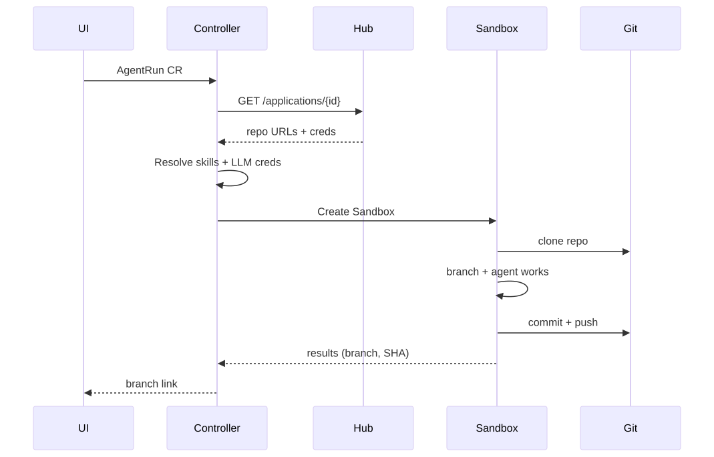

<!-- _class: lead -->


# Konveyor Agentic Platform
## Controller & Base Image

David Zager — June 2026

---

# Where we are

- **POC proved it works** — AI agent in a container migrates code
- Tightly coupled to Hub internals, not reusable
- Need portable, Kubernetes-native primitives

---

# Two enhancements, one system

| Enhancement | Covers |
|---|---|
| **Controller** | CRDs, controllers, Sandbox creation |
| **Base Image** | Harness, git workflow, image layers |

Connected by a shared contract.
Both proceed in parallel.

---

# The landscape

**Lightspeed Agentic** — closest to us
- Uses Agent Sandbox + OCI skills + LLM management
- But domain-locked to cluster ops (fixed Proposal workflow)

**Kagenti** — security/networking middleware, not execution

**Fullsend** — validates git-as-persistence, but GH Actions not k8s

---

# Our opportunity

Generic agent execution primitives that any domain can use:

- Skill resolution from multiple sources (OCI, git, inline)
- LLM provider management and verification
- Git-based workspace lifecycle
- Path to ACP human-in-the-loop

---

# Seven CRDs under `konveyor.io`

**Define capabilities:**
- SkillCard — individual skill or rule
- SkillCollection — group of skills
- LLMProvider — LLM endpoint + credentials + models
- Agent — skills + providers + image + prompt + declared params
- AgentPlaybook — ordered stages

**Execute work:**
- AgentRun — run one Agent with specific values
- AgentPlaybookRun — run a playbook

---

# Agent = template, AgentRun = invocation

Like Tekton Task / TaskRun.

**Agent declares** what's available + what inputs it needs:
- Skills, providers, image, prompt
- Typed parameters (name, type, description, default)

**AgentRun supplies** concrete values:
- Model selections from the Agent's available set
- Parameter values (git URLs, app IDs, anything)
- Task-specific instructions (composed with Agent's prompt)
- `env` / `envFrom` — raw k8s primitives, passed through

---

# Controller is domain-agnostic

The controller does NOT know about Hub, Backstage, git, or
any inventory system.

It validates params, resolves skills to ImageVolumes,
creates a Sandbox, and passes everything through.

Git URLs, Hub tokens, MCP servers — just param values
and env vars to the controller.

**The UI** (or CLI, or Backstage plugin) resolves application
metadata before creating the AgentRun.

---

# SkillCard: three source types

All converge to a resolved OCI image ref in status.

**OCI ref** — pre-built artifact, controller validates it exists

**Git source** — controller clones, builds OCI artifact, pushes

**Inline markdown** — controller builds from CR content, pushes

Mounted into Sandboxes as read-only ImageVolumes.

---

# SkillCollection

Groups skills by referencing:
- SkillCard CRs (by name)
- OCI image refs (directly)
- Git source URLs (creates child SkillCard CRs)

Reports ready when all children are resolved.

---

# In-cluster OCI registry

Skills built from git/inline need somewhere to push.

**OpenShift** — auto-detect built-in image registry

**Vanilla k8s** — Zot (optional Helm subchart)

Controller takes registry URL from config.
Does not own registry lifecycle.

---

# LLMProvider

- Endpoint URL + credential Secret ref
- Declared models with context window sizes and tiers

**Verification:** controller launches a container using
the agent base image to test the real network path.
Updates status with `connectionVerified` and `discoveredModels`.

---

# Agent controller

Watches referenced SkillCards, SkillCollections, LLMProviders.

**Context budget:** sums always-loaded rule content against the
smallest context window across all available models.

Reports readiness when all deps resolved and budget is OK.

---

# Git-as-persistence

Workspaces are **EmptyDir** — ephemeral, die with the pod.

All durable state lives in **git**.

No PVCs survive between runs.

---

# How the workspace works

1. Harness reads params for source/target repo
2. Clones source, creates target branch
3. Agent works, harness commits incrementally
4. Commits `.konveyor/` context files on exit
5. Pushes to target repo
6. Pod dies. Work is in git.

---

# `.konveyor/` on the branch

Committed alongside the code changes:

- **`handoff.md`** — summary for the next stage
- **`session.json`** — model, tokens, timing, tool calls

Next stage's agent reads these on checkout.
Branch content IS the handoff mechanism.

---

# Two repos per application

Hub's Application already models source + assets repos.
The UI resolves these and passes them as params.

**Source repo** — clone from (read-only credentials)

**Assets repo** — push results to (write credentials)

Falls back to source repo on a `konveyor/` branch
if no assets repo is configured.

---



---

# AgentPlaybook

A flat sequence of stages.
Each stage references an Agent and carries instructions.

**discover-and-plan** → **implement** → **review**

---

# How playbook execution works

- All stages share the same target branch
- Each stage = fresh AgentRun, fresh agent session
- Stage 1 commits work + `.konveyor/handoff.md`
- Stage 2 checks out branch, reads handoff, continues
- Stage 3 checks out branch, reviews everything

---

# Base image layers

```text
agent-base                UBI 9 + harness + skillctl + tools
  ├── agent-base-goose      + goose binary
  ├── agent-base-opencode   + opencode binary
  ├── agent-java-goose      + JDK + Maven
  └── agent-full-goose      + all languages
```

---

# The harness

Go binary at `/usr/local/bin/konveyor-harness`

- Reads params for source/target repo, credentials
- Handles git clone/branch/commit/push workflow
- Points runtime at `/opt/skills/`
- Auto-detects which runtime is installed
- Non-root compatible (OpenShift restricted SCC)

---

# Skill mounting: one directory

All skills at `/opt/skills/{skillName}/SKILL.md`.
Built-in + ImageVolumes side by side. No symlinks.

```text
/opt/skills/
  konveyor-migration/SKILL.md   ← baked in
  javax-rules/SKILL.md          ← ImageVolume
  custom-rules/SKILL.md         ← ImageVolume
```

Agent runtime points at `/opt/skills/` and discovers all.

---

# Dependencies

| Project | Role |
|---------|------|
| **Agent Sandbox** (k8s-sigs) | Pod lifecycle — hard dep |
| **skillimage** (redhat-et) | OCI skill packaging — Go library |
| **OpenShell** (NVIDIA) | Security hardening — optional, future |
| **Zot** (project-zot) | In-cluster registry — optional |

---

# Phased rollout

**POC** — AgentRun end-to-end from the UI
Manage Agents, Skills, Providers. Run a migration.

**Phase 2** — AgentPlaybook with flat stages
discover → implement → review on one branch

**Phase 3** — SkillCard git/inline sources + registry
Dynamic skill resolution, in-cluster OCI registry

**Phase 4** — Per-agent memory service
Knowledge accumulates across runs

**Future** — ACP interactive execution
Human-in-the-loop from IDE or terminal

---

<!-- _class: lead -->

# POC: the details

---

# POC: what ships

All seven CRDs defined. Five controllers active.
SkillCards OCI refs only (no git/inline, no registry needed).

The UI can manage the full definition layer:
- Create/edit/delete **SkillCards** and **SkillCollections**
- Create/edit/delete **LLMProviders** (verified by controller)
- Create/edit/delete **Agents** (with context budget)
- Create **AgentRuns** against applications
- View run status and branch links

---

# POC: the UI's role

The UI is the integration point for Hub.
The controller is generic.

1. User picks an application + an agent
2. **UI resolves** from Hub:
   - Source repo URL, branch, path
   - Assets repo URL (or fallback to source)
   - Credential Secret names
3. **UI creates** AgentRun CR with:
   - Param values (source URL, target branch)
   - `envFrom` for git creds, Hub token
   - Model selection + instructions
4. UI watches status, shows branch link on completion

---

# POC: the contract

**Agent declares params** it needs:
```yaml
params:
  - name: source_url
    type: string
  - name: target_branch
    type: string
  - name: source_branch
    type: string
    default: main
```

**AgentRun supplies values + k8s primitives:**
- Param values → injected as `KONVEYOR_PARAM_*` env vars
- `env` / `envFrom` → passed through unchanged
- `instructions` → composed with Agent's prompt

---

# POC: the harness (minimum)

Shell script or small Go binary.
No skillctl, no graphify, no memory.

1. Read `KONVEYOR_PARAM_SOURCE_URL`, `_TARGET_BRANCH`
2. Set up git credentials (from mounted secret)
3. `git clone` → `/workspace/repo`
4. `git checkout -b` target branch
5. Point runtime at `/opt/skills/`
6. Set runtime env vars (model, provider, API key)
7. Run agent in `/workspace/repo`
8. On exit: commit `.konveyor/` context files
9. `git push` to target
10. Write `/.konveyor/results.json` for controller

---

# POC: the controller

1. Validate AgentRun params match Agent's declarations
2. Resolve SkillCards → OCI image refs
3. Resolve LLMProvider → credential Secrets
4. Inject params as `KONVEYOR_PARAM_*` env vars
5. Pass through `env` / `envFrom` unchanged
6. Create Agent Sandbox (image + ImageVolumes + env)
7. Watch Sandbox completion
8. Update AgentRun status

**No Hub calls. No git calls. No inventory calls.**

---

# POC: work by lane

| UI | Controller | Container |
|---|---|---|
| SkillCard CRUD | SkillCard controller | Base image |
| SkillCollection CRUD | SkillCollection controller | Harness script |
| LLMProvider CRUD | LLMProvider controller | Git clone/push |
| Agent CRUD | Agent controller | Runtime config |
| AgentRun create | AgentRun controller | `.konveyor/` commit |
| Resolve app from Hub | | |
| Status + branch link | | |

---

# Phase 2: work by lane

| UI | Controller | Container |
|---|---|---|
| AgentPlaybook CRUD | AgentPlaybook controller | Same harness |
| PlaybookRun create | AgentPlaybookRun controller | Reads handoff.md |
| Per-stage status | Sequential AgentRun creation | Writes handoff |

---

# Phase 3: work by lane

| UI | Controller | Container |
|---|---|---|
| SkillCard git/inline | SkillCard git/inline resolve | skillimage build |
| creation forms | In-cluster registry config | Registry push |

---

# Phase 4+: work by lane

| UI | Controller | Container |
|---|---|---|
| Memory config | Memory PVC management | MCP server startup |
| Memory status | Memory service lifecycle | mempalace process |
| ACP session view | ACP WebSocket Service | ACP transport |
| Permission prompts | Route/Ingress creation | Runtime ACP mode |

---

# Phase 4: Agent memory

Each Agent optionally references a persistent memory service.

- Agent reads from memory at session start
- Writes discoveries at session end
- Knowledge accumulates across all runs of that Agent
- Patterns learned migrating app A help with app B

POC exists: mempalace integration in dymurray/tackle2-addon-kai.
Deployed as a service with its own storage, exposed via MCP.

---

# Future: ACP human-in-the-loop

Agent in a Sandbox exposes ACP over WebSocket.
User connects from IDE or terminal.

Streaming, permission requests, file diffs — same as
a local agent, but running in the cluster with managed
skills, credentials, and security.

**Nobody else in open k8s is building this.**

---

# Next steps

1. Agree on param declarations + harness contract
2. Build controller + base image in parallel
3. POC: single AgentRun from tackle2-ui
4. Phase 2: AgentPlaybook with flat stages

---

# Enhancement PRs

| PR | Enhancement |
|---|---|
| [#295](https://github.com/konveyor/enhancements/pull/295) | Controller |
| [#296](https://github.com/konveyor/enhancements/pull/296) | Base Image |

---

<!-- _class: lead -->


# Questions?
